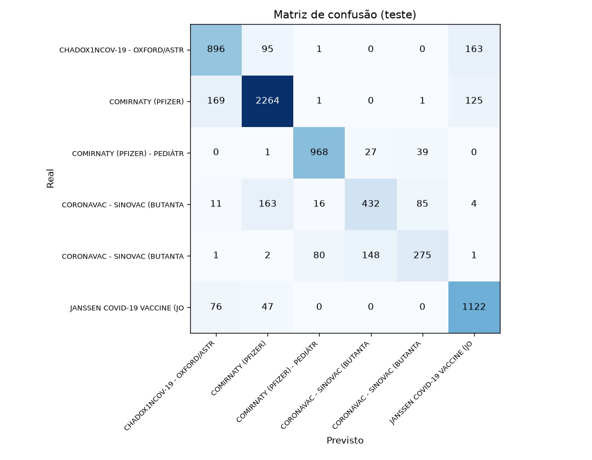

# 💉 AVD — Classificador de Vacinas (COVID-19, Recife)

Projeto da disciplina de **Análise e Visualização de Dados (AVD)** da **CESAR School**.
A partir do perfil de quem foi vacinado, uma **árvore de decisão** prevê **qual vacina a pessoa recebeu**.

> Atividade da Aula 10: melhorar o classificador até **mais de 80% de acurácia no teste**, sem usar a coluna `lote`.

---

## 👥 Nossa Equipe

| Nome | Email |
|------|-------|
| Gabriel Abreu Souza | [gasb2@cesar.school](mailto:gasb2@cesar.school) |
| Rafael Lyra Costa | [rlc3@cesar.school](mailto:rlc3@cesar.school) |
| Mateus José Galvão de Melo Guimarães | [mjgmg@cesar.school](mailto:mjgmg@cesar.school) |

**Disciplina:** Análise e Visualização de Dados (AVD)

---

## 🧒 Em palavras simples

**O que fizemos?** Ensinamos um computador a adivinhar **qual vacina contra a COVID-19 uma pessoa tomou**, olhando só para algumas informações dela: idade, qual dose foi, em que dia tomou e onde mora em Recife.

**Como o computador aprende?** Mostramos a ele milhares de pessoas que já foram vacinadas, com a resposta de cada uma. Ele procura padrões, como "crianças pequenas tomaram a Pfizer pediátrica". Depois, o testamos em pessoas que ele nunca viu e conferimos quantas vezes acertou.

**O que é a "árvore de decisão"?** É um jogo de perguntas, como o "Akinator": *"A pessoa tem menos de 12 anos? Sim. A dose foi a primeira? Não..."*. Cada resposta leva a uma nova pergunta, até chegar num palpite final: a vacina.

**Deu certo?** Sim. O computador acerta **8 em cada 10 vacinas** (82,6%). Se ele chutasse sempre a vacina mais comum, acertaria só 3 em cada 10 (35,5%). Ele aprendeu de verdade.

**Por que ele erra às vezes?** A Coronavac é a mais difícil, porque foi aplicada nas mesmas faixas de idade e épocas que outras vacinas. Nesses casos o computador a confunde, principalmente com a Pfizer.

**Por que não usamos o número do lote?** O lote é como o "número de série" da caixa da vacina, e cada lote pertence a uma única marca. Usá-lo seria colar a resposta na prova: o computador acertaria quase tudo (96,8%), mas só porque já viu a resposta, e isso não serve na vida real. Por isso a regra da atividade proíbe.

**E o que significa a data pesar tanto?** Cada vacina chegou em uma época diferente. O computador percebeu isso: ele aprendeu a **linha do tempo da campanha**, e não um gosto das pessoas.

**Glossário rápido**

| Palavra | Significa |
|---|---|
| Acurácia | Quantas vezes o computador acertou, em porcentagem |
| Linha de base | O resultado de "chutar sempre a vacina mais comum", usado como régua mínima |
| Treino e teste | Treino é o "material de estudo" (80%). Teste é a "prova" com casos novos (20%) |
| Validação cruzada | Ensaiar várias vezes com partes diferentes do material de estudo para escolher o melhor ajuste, sem olhar a prova |
| Overfitting | Decorar o material de estudo em vez de aprender: vai bem no treino e mal na prova |
| Matriz de confusão | Tabela que mostra, para cada vacina real, qual o computador achou que era |

---

## 🎯 Resultado

| | Acurácia no teste |
|---|---|
| Linha de base (sempre responder a vacina mais comum) | **35,5%** |
| Árvore da aula (`max_depth=4`) | 65,3% |
| **Árvore final (ajustada por validação cruzada)** | **82,6%** ✅ |

- **Meta de 80% atingida.** CV 5-fold: 83,0% · treino: 83,9% · teste: 82,6%.
- Treino e teste ficaram próximos, então não há overfitting relevante.
- Teste com `lote`, só para medir o vazamento (não usado no modelo): 96,8%.



**Onde o modelo erra:** Pfizer adulta, Pfizer pediátrica e Janssen são bem separadas (F1 de 0,84 a 0,92).
As Coronavac, adulta e pediátrica, são as mais difíceis (recall de 61% e 54%), e a maior confusão é Coronavac prevista como Pfizer (163 casos).

**O que mais pesou:** `idade` (45%), `dia_do_ano` (37%) e `dose` (8%).
A data pesa muito porque cada vacina foi aplicada em períodos diferentes da campanha: o modelo aprende o calendário da campanha, não uma preferência da pessoa.

---

## 🧪 Tentativas

A escolha de cada versão foi feita pela **validação cruzada no treino**. O teste foi apenas reportado.

| # | Tentativa | CV | Treino | Teste |
|---|-----------|----|--------|-------|
| 1 | Linha de base (dummy) | 35,5% | 35,5% | 35,5% |
| 2 | Árvore da aula, `max_depth=4` | 65,4% | 65,4% | 65,3% |
| 3 | + unidade de saúde e sistema de origem | 65,4% | 65,4% | 65,3% |
| 4 | Data como dia do ano (no lugar do mês) | 66,9% | 66,9% | 66,3% |
| 5 | + grupo, categoria e faixa etária | 66,9% | 66,9% | 66,3% |
| 6 | Mais profundidade (`max_depth=8`) | 79,8% | 80,6% | 79,8% |
| 7 | + município e calendário | 79,6% | 80,6% | 79,7% |
| 8 | GridSearchCV (perfil + dia do ano) | 82,9% | 83,8% | 82,5% |
| 9 | **GridSearchCV (todas as features)** | **83,0%** | **83,9%** | **82,6%** |

**Hiperparâmetros finais:** `criterion=entropy` · `max_depth=None` · `min_samples_leaf=1` · `ccp_alpha=0.0005` (260 features, 192 folhas, profundidade 16).

---

## 💬 Perguntas para discussão

<details>
<summary><b>Por que o lote é vazamento?</b></summary>
<br/>
Cada lote pertence a um único fabricante, então a coluna entrega a resposta. Com ele o teste chega a 96,8%, mas isso não serve em produção, porque o lote só é conhecido depois que a vacina já foi escolhida.
</details>

<details>
<summary><b>O mês é uma boa representação da data?</b></summary>
<br/>
Não é a melhor. Trocar o mês pelo <b>dia do ano</b> deu cerca de +1,5 ponto percentual na CV com árvore rasa. Numa árvore profunda a diferença some quase toda.
</details>

<details>
<summary><b>O que mais ajudou a passar dos 80%?</b></summary>
<br/>
A <b>profundidade</b> da árvore (de 4 para 8 e depois o grid). Colunas extras, como unidade de saúde, sistema de origem, grupo e categoria, não acrescentaram quase nada.
</details>

<details>
<summary><b>A acurácia sozinha engana?</b></summary>
<br/>
Sim. A baseline já acerta 35,5% só respondendo a classe mais comum. Por isso olhamos precisão, recall e a matriz de confusão por classe.
</details>

<details>
<summary><b>O que é overfitting aqui?</b></summary>
<br/>
Com <code>max_depth=None</code> e sem poda, a árvore chegou a 5.966 folhas: 97,7% no treino contra 77,5% no teste. Ela decorou o treino. A poda (<code>ccp_alpha</code>) resolveu.
</details>

---

## 🏗️ Arquitetura

```text
API Recife (dados abertos)
        ↓
Bronze  →  MongoDB Atlas
        ↓  ETL (src/transformer.py)
Silver  →  NeonDB (dado limpo)
        ↓
Modelo  →  árvore de decisão (scikit-learn)
        ↓
Frontend → web/ (resultados e árvore interativa)
```

```text
.
├── run_etl.py          # bronze → silver
├── train.py            # silver → modelo → resultados
├── src/
│   ├── config.py       # fonte, bancos e tabelas
│   ├── extract.py      # lê API, bronze e silver
│   ├── transformer.py  # limpeza e padronização
│   ├── load.py         # grava bronze e silver
│   ├── model.py        # Classificador, Features e Experimentos
│   └── relatorio.py    # exporta os resultados para a web
└── web/                # página com os resultados
```

---

## ▶️ Como rodar

```bash
python -m venv .venv
.venv\Scripts\activate
pip install -r requirements.txt
```

Crie um `.env` na raiz com as conexões:

```env
MONGO_URI=...   # MongoDB Atlas (bronze)
NEON_URL=...    # NeonDB (silver)
```

```bash
python run_etl.py          # bronze → silver (opcional se a silver já existe)
python train.py            # treina, avalia e gera web/data/results.js (1 a 2 min)

cd web
python -m http.server 8000 # abrir http://localhost:8000
```

---

## 🗃️ Dados

Perfil das pessoas vacinadas contra a COVID-19 em Recife, do Portal de Dados Abertos da Prefeitura:
[dados.recife.pe.gov.br](https://dados.recife.pe.gov.br/dataset/perfil-das-pessoas-vacinadas-covid-19)

- **Bronze:** 60.000 registros · **Silver usada no modelo:** 36.064 linhas, 6 classes de vacina.
- **Split:** 80% treino (28.851) e 20% teste (7.213), `random_state=42`, estratificado.
- **Alvo:** `vacina` · **Fora do modelo:** `lote` (vazamento).

---

## 💡 Observações

> Projeto desenvolvido na disciplina de **AVD (Análise e Visualização de Dados)** da **CESAR School**.

> Os dados são do Portal de Dados Abertos da Prefeitura do Recife e são usados para fins acadêmicos.
